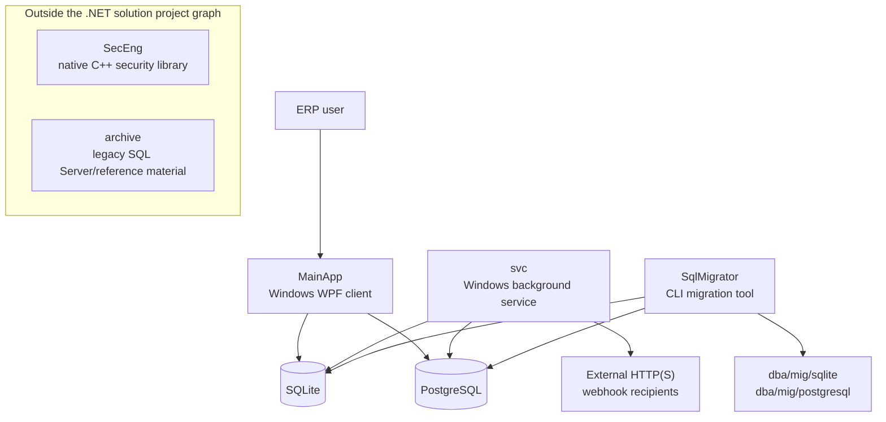
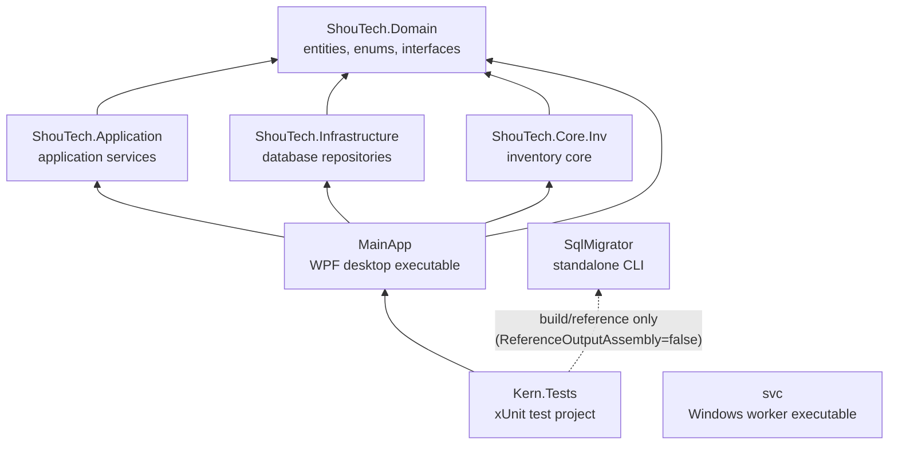
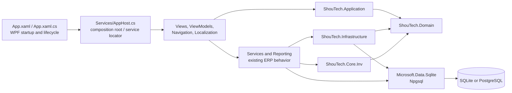
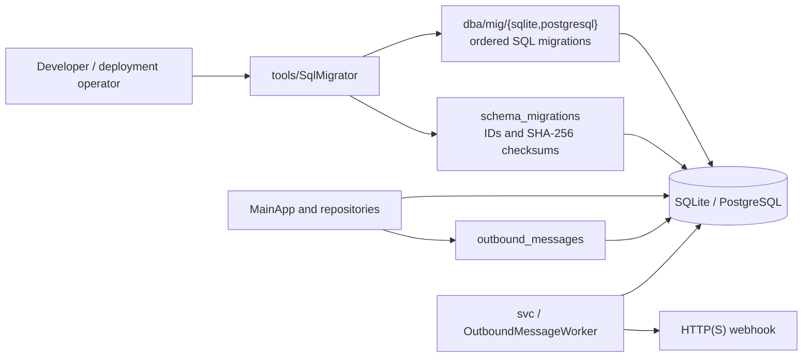

# Repository Architecture

This chart describes the current repository structure and project references. It is an architectural map, not a claim that every module listed in product documentation is fully implemented or wired into one application layer.

## System context

The supported active database providers are SQLite and PostgreSQL. SQL Server assets under `archive/` are reference material, not active provider migrations.

## .NET solution project references

`ShouTech.sln` includes the projects shown above. `sec/` has a separate CMake/C++ build and is not listed as a solution project. The WPF client references both the newer `src/` layers and the inventory core; this is a transitional, mixed architecture rather than a strict single-direction clean-architecture stack.

## Desktop application

- `AppHost.Initialize()` loads application configuration and initializes shared services. It exposes legacy app services and selected newer application/infrastructure services, including journal and accounting-structure services.
- The WPF project includes provider packages directly, as does `ShouTech.Infrastructure`. Database access is therefore not exclusively routed through `ShouTech.Infrastructure`.
- Configuration defaults are in `cfg/appset.json`; connection strings should be supplied through `SHOUTECH_CONNECTION_STRING` or `SHOUTECH_DB_CONNECTION`. Provider selection uses `SHOUTECH_DB_PROVIDER`.

## Database schema and background delivery

The migration tool discovers nested SQL migration files, applies each migration transactionally, and checks stored SHA-256 hashes to detect edits to already-applied files. For an existing database without migration history, it refuses automatic application; `--baseline-existing` should only be used after reviewing the schema and taking a backup.

The service polls the outbox and dispatches HTTP(S) webhooks. Email/SMS connectors and POS synchronization are not currently implemented as active service behavior. The desktop code also contains schema-bootstrap/ensure-schema paths; consult [Database Migrations](docs/DATABASE_MIGRATIONS.md) and the relevant feature code before changing or applying schema behavior.

## Repository map

| Path | Responsibility |
|---|---|
| `cod/app/src/` | WPF startup, views, view models, navigation, services, reporting, localization, and configuration integration |
| `cod/cor/` | Inventory core project and related models, services, repositories, and unit-of-work code |
| `src/ShouTech.Domain/` | Domain entities, enums, and repository/service interfaces |
| `src/ShouTech.Application/` | Application-level services and use-case logic |
| `src/ShouTech.Infrastructure/` | Provider-backed database repositories and health checks |
| `svc/` | Windows service host, outbox worker, and health reporting |
| `tools/SqlMigrator/` | CLI for SQLite/PostgreSQL database migrations |
| `dba/mig/` | Active provider-specific migration histories |
| `sec/` | Native C++ security library and native tests |
| `tests/Kern.Tests/` | .NET xUnit tests |
| `archive/` | Legacy schema snapshots and SQL Server reference scripts |
| `docs/` | Feature, migration, schema, and development documentation |

## Architectural caveats

- The WPF app combines older service/repository implementations with the newer `Domain` / `Application` / `Infrastructure` projects. Follow the actual feature call path before deciding where a change belongs.
- The `svc` and `SqlMigrator` projects reference their database providers directly; they do not depend on the infrastructure project.
- Native security code has its own CMake and Visual Studio project files. Its presence does not, by itself, establish that a managed application build compiles or packages the native library.
- Journal reversal currently changes a posted entry's state and records an audit event; it does not yet create a compensating journal entry. See [Al-Ameen logic adaptation](docs/ALAMEEN_LOGIC_ADAPTATION.md).
- Product documentation describes a wider ERP feature set than the architecture chart can certify as implemented end-to-end.

## Further reading

- [Developer guide](README.dev.md)
- [Database migrations](docs/DATABASE_MIGRATIONS.md)
- [Accounting chart, periods, and year close](docs/ACCOUNTING_CHART_PERIODS_YEAR_CLOSE.md)
- [Al-Ameen logic adaptation and caveats](docs/ALAMEEN_LOGIC_ADAPTATION.md)
