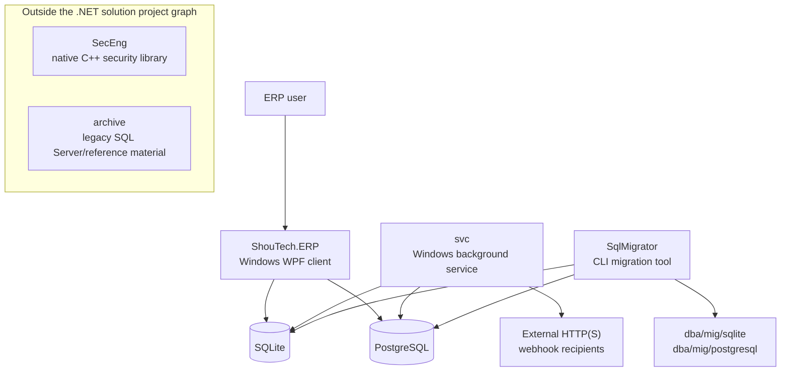
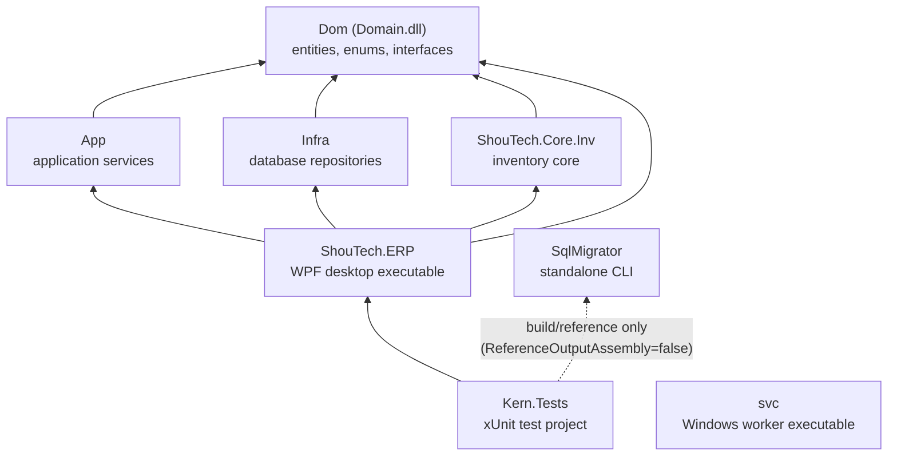
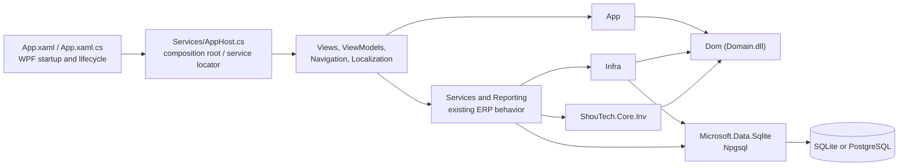
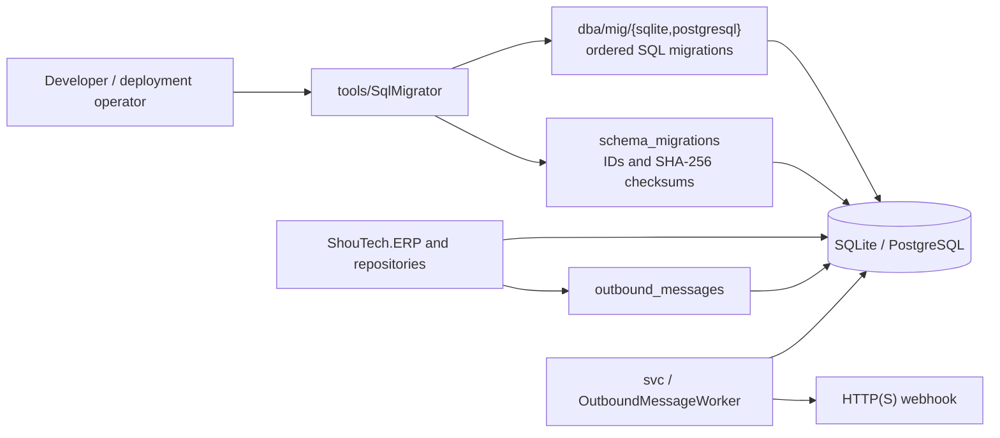

# Repository Architecture

This chart describes the current repository structure and project references. It is an architectural map, not a claim that every module listed in product documentation is fully implemented or wired into one application layer.

## System context

The supported active database providers are SQLite and PostgreSQL. SQL Server assets under `archive/` are reference material, not active provider migrations.

## .NET solution project references

`ShouTech.sln` includes the projects shown above. `sec/` has a separate CMake/C++ build and is not listed as a solution project. The root WPF project is `ShouTech.ERP.csproj` (assembly `ShouTech.ERP`). It references `src/Dom/Dom.csproj` (assembly `Domain`), `src/App/App.csproj` (assembly `App`), `src/Infra/Infra.csproj` (assembly `Infra`), and `src/Inv/Inv.csproj` (assembly `ShouTech.Core.Inv`). The WPF client also retains legacy presentation-facing services; this is a transitional, mixed architecture rather than a strict single-direction clean-architecture stack.

## Desktop application

- `AppHost.Initialize()` loads application configuration and initializes shared services. It exposes legacy app services and selected newer application/infrastructure services, including journal and accounting-structure services.
- The root WPF project includes the SQLite and PostgreSQL provider packages directly, as does `src/Infra/Infra.csproj`. Database access is therefore not exclusively routed through the infrastructure project.
- Configuration defaults are in `cfg/appset.json`; connection strings should be supplied through `SHOUTECH_CONNECTION_STRING` or `SHOUTECH_DB_CONNECTION`. Provider selection uses `SHOUTECH_DB_PROVIDER`.

## Database schema and background delivery

The migration tool discovers nested SQL migration files, applies each migration transactionally, and checks stored SHA-256 hashes to detect edits to already-applied files. For an existing database without migration history, it refuses automatic application; `--baseline-existing` should only be used after reviewing the schema and taking a backup.

The service polls the outbox and dispatches HTTP(S) webhooks. Email/SMS connectors and POS synchronization are not currently implemented as active service behavior. The desktop code also contains schema-bootstrap/ensure-schema paths; consult [Database Migrations](DATABASE_MIGRATIONS.md) and the relevant feature code before changing or applying schema behavior.

## Repository map

| Path | Responsibility |
|---|---|
| `ShouTech.ERP.csproj`, `App.xaml`, `App.xaml.cs` | Sole Windows desktop application and bootstrap |
| `app/` | WPF views, view models, services, navigation, reporting, localization, themes, and resources |
| `src/Dom/` | Domain entities, value types, contracts, and business rules |
| `src/App/` | Application use cases and orchestration |
| `src/Infra/` | SQLite/PostgreSQL persistence and infrastructure adapters |
| `src/Inv/` | Inventory core library |
| `dba/` | Authoritative schema assets and provider-specific migration history |
| `svc/` | Independent Windows background worker |
| `tools/` | SQL migration CLI and developer verification harnesses |
| `tests/` | Automated regression and integration tests |
| `sec/` | Native C++ security library and native tests |
| `cfg/` | Non-secret application defaults |
| `docs/` | Architecture, product, engineering, and user documentation |
| `archive/` | Historical schema snapshots and legacy reference material |

## Architectural caveats

- The WPF app combines older service/repository implementations with the newer `Dom` / `App` / `Infra` projects. Follow the actual feature call path before deciding where a change belongs.
- The `svc` and `SqlMigrator` projects reference their database providers directly; they do not depend on the infrastructure project.
- Native security code has its own CMake and Visual Studio project files. Its presence does not, by itself, establish that a managed application build compiles or packages the native library.
- Journal reversal creates a posted compensating journal entry (every source line copied with debit and credit swapped) linked through `reversal_of_entry_id`, marks the original entry as reversed, and writes audit events for both entries in one transaction. A unique partial index on `reversal_of_entry_id` prevents a second reversal of the same source entry. The legacy in-memory `AccServ` in `app` does not expose a reversal operation yet; posted corrections must go through the `src/` journal services. See [Accounting reversals](ACCOUNTING_CHART_PERIODS_YEAR_CLOSE.md).
- Product documentation describes a wider ERP feature set than the architecture chart can certify as implemented end-to-end.

## Further reading

- [Developer Roadmap](DEVELOPER_ROADMAP.md) — canonical phased delivery plan and release gates.
- [Developer Handbook](DEVELOPER_HANDBOOK.md) — required engineering practices and quality gates.
- [Module Catalog](MODULE_CATALOG.md) — module responsibilities, dependencies and acceptance evidence.
- [Engineering Reference Library](ENGINEERING_REFERENCE_LIBRARY.md) — external standards and product references.

- [Developer guide](DEV.md)
- [Database migrations](DATABASE_MIGRATIONS.md)
- [Accounting chart, periods, and year close](ACCOUNTING_CHART_PERIODS_YEAR_CLOSE.md)
- [Al-Ameen logic adaptation and caveats](ALAMEEN_LOGIC_ADAPTATION.md)

## Architecture refactoring program

The repository is being re-engineered incrementally. The audited target architecture, dependency rules, module boundaries, file-disposition policy and phase exit gates are maintained in [Architecture Refactoring Plan](REFACTOR.md). Do not treat this target as evidence that all legacy paths have already been migrated.
